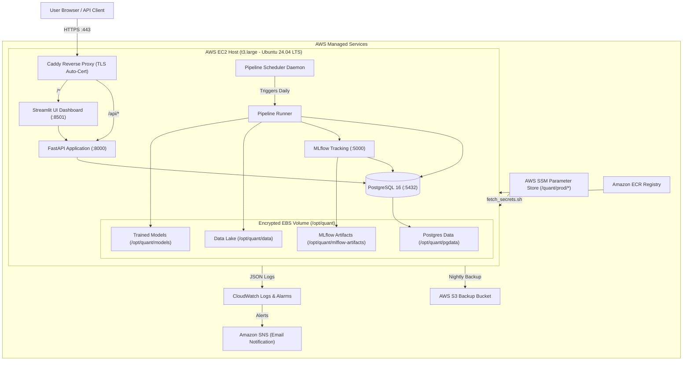

# Quantitative AI Research Platform — AWS Deployment Architecture & Operations Guide

**Version:** 1.0.0  
**Target Environment:** AWS ap-south-1 (Mumbai) / Multi-region  
**Compute Model:** Single-Node Hardened Docker Compose on EC2 behind Caddy HTTPS Proxy

---

## 1. System Architecture



---

## 2. Infrastructure Sizing & Monthly Cost Estimate

| Resource | Specification | Purpose | Est. Monthly Cost (USD)* |
|---|---|---|---|
| **EC2 Instance** | `t3.large` (2 vCPUs, 8 GB RAM) | API, UI, Scheduler, DB, MLflow | ~$60.74 (On-Demand) |
| **Root EBS Volume** | 30 GB gp3 | OS & Docker Images | ~$2.40 |
| **Data EBS Volume** | 60 GB gp3 (Encrypted) | Data Lake, Models, Postgres | ~$4.80 |
| **Elastic IP** | 1 IPv4 Address | Static Public IP (No charge when attached) | $0.00 (Free while attached) |
| **S3 Backup Storage** | ~20 GB (Standard) | 30-Day Versioned Backups | ~$0.50 |
| **CloudWatch Logs** | 5 GB Ingestion | JSON Application Access Logs | ~$2.50 |
| **Total Estimated Cost** | — | — | **~$70.94 / month** |

*\*Note: Costs are estimates for AWS Region `ap-south-1` (Mumbai). A student AWS Free Tier account or stopping the instance outside research hours can reduce costs to < $20/month.*

---

## 3. Operations Runbook (Day-2)

### A. Deploy a New Release
1. Build and push image from your local machine:
   ```powershell
   ./deploy/aws/scripts/push_release.ps1 -Tag v1.0.1
   ```
2. Connect to the EC2 host via AWS SSM:
   ```bash
   aws ssm start-session --target <INSTANCE_ID>
   ```
3. Execute deployment:
   ```bash
   sudo /opt/quant/deploy.sh v1.0.1
   ```

### B. Automated Rollback
If a deployment fails health checks or smoke tests, `deploy.sh` automatically rolls back to the previous tag recorded in `/opt/quant/releases/previous`. To manually roll back:
```bash
sudo /opt/quant/rollback.sh
```

### C. Secret Rotation
1. Update parameters in SSM Parameter Store:
   ```bash
   aws ssm put-parameter --name "/quant/prod/POSTGRES_PASSWORD" --value "<new-pass>" --type SecureString --overwrite
   ```
2. Pull updated secrets into `/opt/quant/.env` and restart containers:
   ```bash
   sudo /opt/quant/fetch_secrets.sh prod
   sudo systemctl restart quant.service
   ```

### D. Manual Backup & Restore Drill
- Run a manual backup:
  ```bash
  sudo /opt/quant/backup.sh
  ```
- Run a restore drill into a safe scratch database:
  ```bash
  sudo /opt/quant/restore.sh <BACKUP_DATE_TAG>
  ```

---

## 4. Legal & Regulatory Compliance Flags

1. **SEBI Regulations (India):**
   - The platform is strictly an academic research tool. It is **NOT** registered with SEBI under the Investment Advisers Regulations (2013) or Research Analysts Regulations (2014).
   - Public deployment must enforce authentication (`DASHBOARD_PASSWORD`) and read-only mode (`DASHBOARD_READ_ONLY=true`).
2. **Market Data Terms of Service:**
   - Free data feeds via `yfinance` are intended for personal research. For public or institutional use, users must license feeds from authorized exchange vendors.
3. **Index Licensing:**
   - "NIFTY 50" and "NIFTY 500" are registered trademarks of NSE Indices Limited. Used solely for algorithmic backtest benchmarking.
