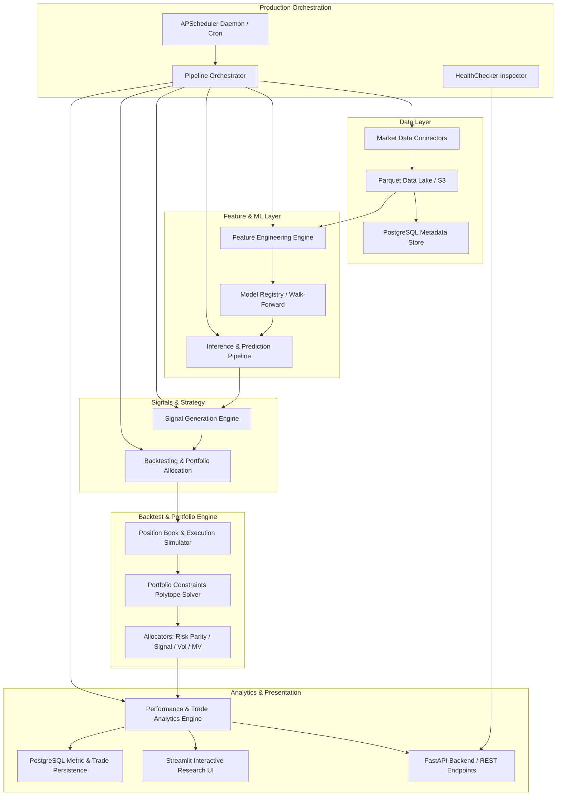

# Platform Architecture: Quantitative AI Research & Production Platform

## 1. System Overview

The Quantitative AI Research and Production Platform is a modular, high-throughput, capital-constrained trading system designed for quantitative alpha research, systematic risk modeling, dynamic portfolio construction, and automated daily execution.

## 2. Core Subsystems

### 2.1 Backtesting Engine (Week 10)
- **`WeightedPortfolioSimulator`**: Chronological daily stepping engine supporting realistic capital constraints, fractional cash reserves, stop-loss / take-profit triggers, multi-day execution lag, and deterministic rebalancing.
- **`PositionBook`**: Average-cost basis accounting tracking long and short inventory lots, realized PnL, open exposures, and partial lot reductions.
- **`BacktestStore`**: Atomic file storage persisting configuration, trade logs, portfolio histories, and daily exposure snapshots to disk with path-traversal sanitization.

### 2.2 Portfolio Construction Layer (Week 11)
- **`Allocator` Protocol**: Clean interface decoupling allocation mathematical solvers from execution logic.
- **`PortfolioConstraints`**: Non-linear projection onto feasible polytope enforcing position caps, cash reserves, sector exposure limits, and minimum lot thresholds.
- **Allocators**:
  - `EqualWeightAllocator`: Uniform capital distribution across active symbols.
  - `SignalWeightedAllocator`: Conviction-based allocation scaling by model prediction confidence.
  - `VolatilityWeightedAllocator`: Inverse-volatility risk budgeting.
  - `RiskParityAllocator`: Equal risk contribution (ERC) solver via Sequential Least Squares Programming (SLSQP).
  - `MeanVarianceAllocator`: Quadratic utility optimization with shrinkage covariance.

### 2.3 Analytics Subsystem (Week 12)
- **`PerformanceMetrics`**: Computes annualized returns, annualized volatility, Sharpe ratio, Sortino ratio, max drawdown, Calmar ratio, historical VaR / CVaR (95%), best/worst single day, and max drawdown duration in calendar days.
- **`TradeAnalytics`**: Win/loss rates, profit factor, payoff ratio, expectancy, average duration, streaks, return distributions, and per-symbol PnL.
- **`BenchmarkComparison` & `BenchmarkBuilder`**: Aligns passive index benchmarks or equal-weight market universes, calculating Jensen's alpha, beta, tracking error, information ratio, Pearson correlation, and upside/downside capture ratios.
- **`ReportBuilder`**: Consolidates simulation outputs into JSON-ready `StrategyReport` instances.
- **`BacktestPipeline`**: Cross-layer pipeline orchestrating data loading, simulation execution, benchmark alignment, reporting, and database persistence.

### 2.4 Dashboard & REST API (Week 12)
- **FastAPI Backend (`src/dashboard/api/`)**: High-performance REST API with OpenAPI documentation, header-based API key authentication, and background job scheduling.
- **Streamlit Frontend (`src/dashboard/`)**: Interactive research dashboard dispatching across 9 specialized views (Overview, Performance, Trades, Allocation, Benchmark, Signals, Experiments, Pipeline, Run Backtest).
- **`DashboardClient` Protocol**: Pluggable interface supporting in-process (`LocalClient`) and remote HTTP (`ApiClient`) execution.

### 2.5 Automation & Production Readiness (Week 13)
- **`PipelineOrchestrator`**: Sequential DAG execution with strict failure propagation (downstream steps SKIPPED on upstream failure).
- **`RunHistory`**: Atomic disk persistence for daily execution run reports.
- **`HealthChecker`**: Operational status monitoring verifying database reachability, feature/signal data freshness, and model artifact health.
- **`BlockingScheduler`**: Production cron trigger executing daily pipelines at configured local times.

## 3. Strict Architectural Invariants
1. **Modularity**: Every source file is strictly <= 300 lines.
2. **Unidirectional Dependencies**: `backtesting -> portfolio -> analytics -> dashboard`.
   - `backtesting` never imports from `portfolio` or `analytics`.
   - `portfolio` never imports from `analytics`.
3. **Immutability & Safety**: No mutating shared structures; atomic file operations via tempfile rename.
4. **Resilience**: Database failures in analytics or dashboard never crash file outputs or core workflows.
